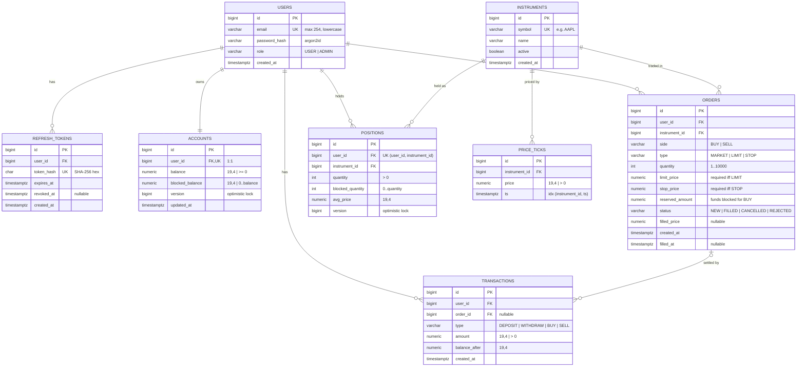

# Trading Simulator

Symulator giełdy: rejestracja i logowanie (JWT), konto gotówkowe, instrumenty, zlecenia, pozycje.

## Spis treści
1. [Struktura repozytorium](#struktura-repozytorium)
2. [Wymagania](#wymagania)
3. [Konfiguracja (.env)](#konfiguracja-env)
4. [Baza danych (Docker)](#baza-danych-docker)
5. [Uruchomienie aplikacji](#uruchomienie-aplikacji)
6. [Testy](#testy)
7. [Swagger / OpenAPI](#swagger--openapi)
8. [Konto administratora](#konto-administratora)
9. [API: przegląd endpointów](#api-przegląd-endpointów)
10. [Migracje bazy (Flyway)](#migracje-bazy-flyway)
11. [Rozwiązywanie problemów](#rozwiązywanie-problemów)
12. [Diagram ERD](#diagram-erd)

## Struktura repozytorium
```
backend/                 Spring Boot 3.5 (Java 21), Maven wrapper
  src/main/java/.../     config, controllers, services, repositories, entities, dto, exceptions, security
  src/main/resources/db/migration/   migracje Flyway (V1, V2, ...)
frontend/                React + Vite + TS (w przygotowaniu)
docs/BUSINESS_RULES.md   reguły biznesowe (BRxx), testy nazwane BRxx_opis
docker-compose.yml       PostgreSQL 16
.env.example             szablon konfiguracji
```

## Wymagania
- **Java 21+** (`java -version`)
- **Docker Desktop**: uruchomiony, potrzebny do bazy danych i do testów (Testcontainers)
- Maven **nie** jest potrzebny, projekt ma wrapper `mvnw`

## Konfiguracja (.env)
Cała konfiguracja jest w pliku `.env` w katalogu głównym. Plik nie trafia do repo (`.gitignore`).
Czytają go zarówno docker compose, jak i backend (`spring.config.import`).

Przy pierwszym uruchomieniu:
```powershell
Copy-Item .env.example .env
```
i uzupełnij w `.env`:

| Zmienna | Opis |
|---|---|
| `DB_HOST`, `DB_PORT`, `DB_NAME`, `DB_USERNAME`, `DB_PASSWORD` | połączenie z bazą; te same wartości użyje kontener |
| `JWT_SECRET` | klucz HS256, **min. 32 bajty**, np. `openssl rand -base64 48`. Bez niego aplikacja nie wystartuje |
| `CORS_ALLOWED_ORIGINS` | adresy frontendu oddzielone przecinkami (domyślnie `http://localhost:5173`) |
| `MARKET_OPEN_TIME`, `MARKET_CLOSE_TIME` | godziny sesji w strefie Europe/Warsaw, pn–pt (domyślnie `09:00`–`17:00`) |
| `MARKET_ALWAYS_OPEN` | `true` = rynek otwarty zawsze, np. na demo (domyślnie `false`) |
| `MARKET_TICK_INTERVAL_MS` | co ile ms symulator generuje nowe ceny (domyślnie `3000`) |
| `MARKET_VOLATILITY` | odchylenie standardowe zmiany ceny w jednym ticku, np. `0.005` = 0,5% |
| `MARKET_SIMULATOR_ENABLED` | `false` wyłącza generowanie cen (domyślnie `true`; w testach wyłączone) |
| `MARKET_TICK_RETENTION_DAYS` | co godzinę usuwane są ceny starsze niż tyle dni; ostatnia cena każdego instrumentu zostaje zawsze (domyślnie `7`) |

Zmienne ustawione w systemie mają pierwszeństwo przed `.env`.

## Baza danych (Docker)
Wszystkie komendy wykonuj z katalogu głównego repo.

| Co | Komenda |
|---|---|
| Uruchom bazę | `docker compose up -d db` |
| Status | `docker compose ps` |
| Logi | `docker compose logs -f db` |
| Zatrzymaj (dane zostają) | `docker compose stop db` |
| Usuń kontener (dane zostają w wolumenie) | `docker compose down` |
| **Usuń kontener i wszystkie dane** | `docker compose down -v` |
| Konsola SQL | `docker compose exec db psql -U trading -d trading` |

Baza jest wystawiona na porcie **5433** (`DB_PORT`), żeby nie kolidować z lokalnie zainstalowanym PostgreSQL na 5432.
Schemat tworzy Flyway przy starcie aplikacji, więc nic nie trzeba zakładać ręcznie.

## Uruchomienie aplikacji
**Z terminala:**
```powershell
docker compose up -d db
cd backend
./mvnw spring-boot:run
```
Aplikacja startuje na `http://localhost:8080`. Zatrzymanie: `Ctrl+C`.

> `mvnw` trzeba uruchamiać z katalogu `backend/`, bo tam jest `pom.xml`.
> Alternatywnie z katalogu głównego: `./backend/mvnw -f backend spring-boot:run`.

**Z IntelliJ:**
1. Jednorazowo: prawy klik na `backend/pom.xml` → *Add as Maven Project* (lub *Reload Maven Project*).
2. `docker compose up -d db`
3. Uruchom `TradingPlatformApplication` (zielona strzałka przy `main`).

**Bez docker-compose (baza w Testcontainers):** uruchom `TestTradingPlatformApplication` z `src/test/java`.
Aplikacja sama postawi tymczasowego Postgresa (wymaga działającego Dockera). Dane znikają po zatrzymaniu.

**Zbudowanie JAR-a:**
```powershell
cd backend
./mvnw clean package          # z testami
./mvnw clean package -DskipTests
java -jar target/tradingPlatform-0.0.1-SNAPSHOT.jar   # uruchom z katalogu backend/ lub głównego (.env)
```

## Testy
Testy integracyjne używają **prawdziwego PostgreSQL w Testcontainers**, więc Docker musi działać.
Baza z docker-compose **nie** jest używana ani modyfikowana.

```powershell
cd backend
./mvnw test                                        # wszystkie testy
./mvnw test -Dtest=AuthIntegrationTest             # jedna klasa
./mvnw test -Dtest=AuthIntegrationTest#me_withValidToken_returns200WithCurrentUser   # jeden test
./mvnw test '-Dtest=*Test#BR16*'                   # wszystkie testy danej reguły biznesowej (wzorzec nazwy metody)
./mvnw clean verify                                # pełny build: kompilacja + testy + JAR
```
W IntelliJ: prawy klik na klasie lub katalogu `src/test/java` → *Run Tests*.

Jak to działa:
- `IntegrationTest` to klasa bazowa: jeden kontener Postgres na cały przebieg testów (`@ServiceConnection`), `MockMvc`
  i helpery (`register`, `login`, `withBearer`, ...).
- Przed każdym testem tabele są czyszczone (`TRUNCATE`), więc testy są od siebie niezależne.
- Testy reguł biznesowych mają nazwy `BRxx_opis` zgodne z `docs/BUSINESS_RULES.md`.
- Sekret JWT dla testów jest w `src/test/resources/config/application.properties`, więc `.env` nie jest potrzebny.

## Swagger / OpenAPI
- UI: http://localhost:8080/swagger-ui/index.html
- Specyfikacja JSON: http://localhost:8080/v3/api-docs

Jak wywołać chroniony endpoint ze Swaggera:
1. Rozwiń **Auth → POST /api/auth/login**, *Try it out*, wpisz np. konto admina (niżej) i *Execute*.
2. Skopiuj wartość `accessToken` z odpowiedzi.
3. Kliknij **Authorize** (kłódka u góry), wklej **sam token**, bez prefiksu `Bearer `, i zatwierdź.
4. Teraz działają endpointy z kłódką, np. `GET /api/users/me`, `GET /api/admin/ping`.

Access token jest ważny 15 minut. Po wygaśnięciu zaloguj się ponownie albo użyj `POST /api/auth/refresh`.

## Konto administratora
Migracja `V3__seed_admin.sql` tworzy konto do testów:

| Email | Hasło | Rola |
|---|---|---|
| `admin@trading.local` | `Admin12345` | `ADMIN` |

To konto jest tylko do celów deweloperskich i prezentacji. W każdym innym środowisku zmień hasło albo usuń to konto.

Zwykłego użytkownika zakładasz przez `POST /api/auth/register` (rola `USER`).

## API: przegląd endpointów
| Metoda | Ścieżka | Dostęp | Opis |
|---|---|---|---|
| POST | `/api/auth/register` | publiczny | rejestracja → 201 `{id, email, role}` |
| POST | `/api/auth/login` | publiczny | logowanie → `{accessToken, refreshToken, tokenType, expiresIn}` |
| POST | `/api/auth/refresh` | publiczny | rotacja tokenów (stary refresh token zostaje unieważniony) |
| POST | `/api/auth/logout` | publiczny | unieważnia refresh token → 204 |
| GET | `/api/users/me` | zalogowany | dane bieżącego użytkownika |
| GET | `/api/account` | zalogowany | własne konto gotówkowe `{balance, blockedBalance, available}`; `available = balance − blockedBalance` |
| POST | `/api/account/deposit` | zalogowany | wpłata `{amount}` (> 0, max 4 miejsca po przecinku, max 1 000 000) → stan konta |
| POST | `/api/account/withdraw` | zalogowany | wypłata `{amount}` tylko z dostępnych środków → stan konta; 409 `INSUFFICIENT_FUNDS` |
| GET | `/api/transactions?page=&size=&type=` | zalogowany | własne transakcje od najnowszej `{content, page, size, totalElements, totalPages}`; `size` 1–100 (domyślnie 20), `type` = `DEPOSIT`/`WITHDRAW`/`BUY`/`SELL` |
| POST | `/api/orders` | zalogowany | zlecenie `{side, type, instrumentId, quantity, limitPrice?, stopPrice?}` → 201; MARKET wykonuje się od razu po ostatniej cenie; LIMIT/STOP zostają jako `NEW`: BUY rezerwuje środki (`reservedAmount`), SELL blokuje akcje; 409 `MARKET_CLOSED`/`INSUFFICIENT_FUNDS`/`INSUFFICIENT_SHARES`, 404/422 dla instrumentu |
| GET | `/api/orders?page=&size=&status=` | zalogowany | własne zlecenia od najnowszego (strona jak w `/api/transactions`); `status` = `NEW`/`FILLED`/`CANCELLED`/`REJECTED` |
| GET | `/api/orders/{id}` | zalogowany | szczegóły własnego zlecenia; cudze lub nieistniejące → 404 `ORDER_NOT_FOUND` |
| GET | `/api/positions` | zalogowany | własne pozycje po symbolu `{instrumentId, symbol, quantity, blockedQuantity, avgPrice, currentPrice, marketValue, unrealizedPnl, unrealizedPnlPct}` wycenione po ostatniej cenie |
| GET | `/api/instruments` | zalogowany | aktywne instrumenty z ostatnią ceną `{id, symbol, name, active, lastPrice, lastPriceAt}` |
| GET | `/api/instruments/{id}` | zalogowany | szczegóły instrumentu (także nieaktywnego); 404 `INSTRUMENT_NOT_FOUND` |
| GET | `/api/instruments/{id}/prices?from=&to=&limit=` | zalogowany | historia cen `[{price, ts}]` rosnąco po czasie: ostatnie `limit` ticków z `[from, to]` (domyślnie 200, max 1000; `from`/`to` w ISO-8601, np. `2026-01-01T10:00:00Z`); 400 `INVALID_TIME_RANGE` gdy `from` > `to` |
| GET | `/api/market/status` | zalogowany | stan rynku `{open, nextChange}`; `nextChange` = najbliższe otwarcie/zamknięcie, `null` gdy rynek zawsze otwarty |
| GET | `/api/admin/ping` | `ADMIN` | test uprawnień → `{"status":"pong"}` |
| POST | `/api/admin/instruments` | `ADMIN` | dodanie instrumentu `{symbol, name, initialPrice}` → 201; 409 `SYMBOL_TAKEN` |
| PATCH | `/api/admin/instruments/{id}` | `ADMIN` | włączenie/wyłączenie instrumentu `{active}`; 404 `INSTRUMENT_NOT_FOUND` |

Błędy zwracane są jako **ProblemDetail** (RFC 9457, `application/problem+json`), np.:
```json
{ "type": "about:blank", "title": "Conflict", "status": 409,
  "detail": "Email is already registered.", "instance": "/api/auth/register", "code": "EMAIL_TAKEN" }
```
Błędy walidacji (400) zawierają dodatkowo `errors: [{field, message}]`.

Przykład z PowerShell:
```powershell
$t = Invoke-RestMethod -Method Post http://localhost:8080/api/auth/login `
     -ContentType 'application/json' -Body '{"email":"admin@trading.local","password":"Admin12345"}'
Invoke-RestMethod http://localhost:8080/api/users/me -Headers @{ Authorization = "Bearer $($t.accessToken)" }
```

## Migracje bazy (Flyway)
- Pliki: `backend/src/main/resources/db/migration/V<numer>__<opis>.sql`
- Zmiana schematu = **nowy plik** z kolejnym numerem. **Nigdy nie edytuj** migracji, która była już uruchomiona,
  bo Flyway wykryje zmianę sumy kontrolnej i aplikacja nie wystartuje.
- Hibernate działa w trybie `ddl-auto=validate`: tylko sprawdza, czy encje pasują do schematu, niczego nie tworzy.
- `V4__seed_instruments.sql` dodaje 8 instrumentów (AAPL, MSFT, NVDA, TSLA, AMZN, GOOGL, META, PKO) z ceną startową.
- Reset lokalnej bazy do zera: `docker compose down -v && docker compose up -d db`, potem start aplikacji.

## Rozwiązywanie problemów
| Objaw | Przyczyna / rozwiązanie |
|---|---|
| `JWT secret (env JWT_SECRET) must be at least 32 bytes` | brak `.env` albo za krótki `JWT_SECRET` |
| `No plugin found for prefix 'spring-boot'` | `mvnw` uruchomiony spoza `backend/`; zrób `cd backend` |
| `password authentication failed for user "trading"` | na porcie łączy się inny Postgres (np. lokalna instalacja); sprawdź `DB_PORT` w `.env` |
| `Connection refused` przy starcie | baza nie działa: `docker compose up -d db` |
| Testy: `Could not find a valid Docker environment` | uruchom Docker Desktop |
| `Validate failed: Migration checksum mismatch` | edytowano zastosowaną migrację; cofnij zmianę i dodaj nową migrację (lokalnie można `docker compose down -v`) |
| IntelliJ pokazuje błędy, a `mvnw` działa | *Reload All Maven Projects* |

## Diagram ERD


